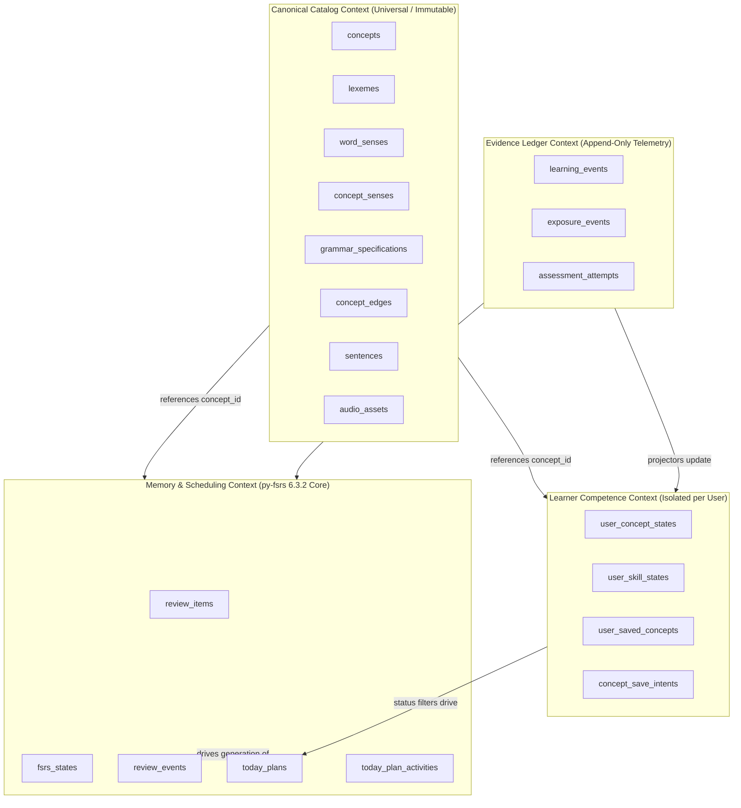

# LINGUA OS Knowledge System V2 — Domain Model Specification

**Status**: Approved Master Specification
**Baseline Commit**: `c2db86387e0879f56817cd748899e80f46b5d79a`
**Classification**: `PROPOSAL` (V2 Architecture) / `FACT` (Repository Alignment)
**Target Subsystems**: `services/api/src/lingua_api/`, `database/migrations/`, `contracts/`

---

## 1. Executive Summary & Ubiquitous Language

The Knowledge System V2 domain model defines the enterprise data structures and bounded contexts powering LINGUA OS. It models the reality of language acquisition: language consists of objective linguistic units (canonical knowledge), while learning is an individual, time-dependent, multi-dimensional cognitive journey (learner state and evidence).

### 1.1 Ubiquitous Language Glossary

| Term | Domain Context | Rigorous Definition |
| :--- | :--- | :--- |
| **Concept** | Canonical Knowledge | The atomic unit of pedagogical instruction and learner memory tracking. Anchors learner competence and FSRS memory. |
| **Lexeme** | Canonical Knowledge | A single, deduplicated morphological root / lemma belonging to a specific language and part of speech (e.g., *bank* as a noun). |
| **Word Sense** | Canonical Knowledge | A specific, unambiguous semantic meaning of a lexeme, accompanied by a bilingual definition, CEFR level, and example sentences. |
| **Concept Sense** | Canonical Knowledge | Relational bridge connecting a pedagogical concept to a specific word sense, enabling polysemous concepts without lemma duplication. |
| **Grammar Spec** | Canonical Knowledge | A structured syntactic rule or pattern (e.g., `S + have/has + V3/ed`) with communicative function and L1 contrastive notes. |
| **Concept Edge** | Canonical Knowledge | A directed, typed semantic or pedagogical relationship connecting two concepts (e.g., `prerequisite_of`, `collocates_with`). |
| **Learner Concept State** | Learner Knowledge | The aggregate competence profile of a learner for a specific concept, tracking Bayesian beta-binomial beliefs across dimensions. |
| **Competence Dimension** | Learner Knowledge | An orthogonal modality of language mastery: `recognition` (reading/listening comprehension), `listening` (acoustic decoding), or `production` (speaking/writing generation). |
| **FSRS State** | Scheduling & Memory | The py-fsrs 6.3.2 parameters (`stability`, `difficulty`, `due_at`, `reps`, `lapses`, `state`, `step`) representing memory retrievability for a single concept. |
| **Review Item** | Scheduling & Memory | The persistent anchor linking a learner to a concept for spaced repetition scheduling. Exactly one primary review item per `(user_id, concept_id)`. |
| **Learning Event** | Evidence | An immutable, append-only record of an active cognitive response (review rating, quiz submission, cloze entry). Updates competence and memory. |
| **Exposure Event** | Evidence | An immutable, append-only record of a passive linguistic encounter (reading an article sentence, looking up a word). Does **not** activate FSRS scheduling. |
| **Today Plan** | Scheduling | A deterministic daily schedule containing time-budgeted activities (review, remediation, new learning, reading) customized to the learner's current state. |

---

## 2. Bounded Context Architecture

Knowledge System V2 is organized into six strictly delineated bounded contexts:



---

## 3. Comprehensive Entity-Relationship Diagram (ERD)

```
+--------------------------------------------------------------------------------------------------------------------+
|                                             CANONICAL KNOWLEDGE TIER                                               |
+--------------------------------------------------------------------------------------------------------------------+
|                                                                                                                    |
|   +-----------------------+              +------------------------+              +-----------------------------+   |
|   | data_sources          |              | licenses               |              | languages                   |   |
|   |-----------------------|              |------------------------|              |-----------------------------|   |
|   | id: uuid (PK)         |              | id: uuid (PK)          |              | code: text (PK)             |   |
|   | code: text (UQ)       |              | code: text (UQ)        |              | name: text                  |   |
|   | name: text            |              | name: text             |              | native_name: text           |   |
|   +-----------+-----------+              +-----------+------------+              +--------------+--------------+   |
|               |                                      |                                          |                  |
|               +-------------------+   +--------------+                                          |                  |
|                                   |   |                                                         |                  |
|                                   v   v                                                         v                  |
|                           +-------------------------------+                     +------------------------------+   |
|                           | concepts                      |<--------------------+ framework_mappings           |   |
|                           |-------------------------------|                     |------------------------------|   |
|                           | id: uuid (PK)                 |                     | id: uuid (PK)                |   |
|                           | language_code: text (FK)      |                     | concept_id: uuid (FK)        |   |
|                           | concept_type: text (CHECK)    |                     | framework_code: text         |   |
|                           | canonical_key: text (UQ)      |                     | level_code: text (A1-C2)     |   |
|                           | status: text                  |                     +------------------------------+   |
|                           | license_id: uuid (FK)         |                                                        |
|                           | source_record_id: uuid (FK)   |                                                        |
|                           +---------------+---------------+                                                        |
|                                           |                                                                        |
|                 +-------------------------+--------------------------+                                             |
|                 |                         |                          |                                             |
|                 v                         v                          v                                             |
|   +---------------------------+ +--------------------+ +---------------------------+                               |
|   | concept_senses (BRIDGE)   | | concept_edges      | | grammar_specifications    |                               |
|   |---------------------------| |--------------------| |---------------------------|                               |
|   | concept_id: uuid (PK, FK) | | id: uuid (PK)      | | id: uuid (PK)             |                               |
|   | word_sense_id: uuid (FK)  | | source_concept_id  | | concept_id: uuid (FK, UQ) |                               |
|   | is_primary: boolean       | | target_concept_id  | | pattern_formula: text     |                               |
|   +-------------+-------------+ | relation_type: text| | syntactic_category: text  |                               |
|                 |               | weight: real       | | pragmatic_function: text  |                               |
|                 v               +--------------------+ | vietnamese_explanation:text|                               |
|   +---------------------------+                        | structural_slots: jsonb   |                               |
|   | word_senses               |                        +---------------------------+                               |
|   |---------------------------|                                                                                    |
|   | id: uuid (PK)             |                        +---------------------------+                               |
|   | lexeme_id: uuid (FK)      |                        | sentences                 |                               |
|   | sense_order: smallint     |                        |---------------------------|                               |
|   | definition_en: text       |                        | id: uuid (PK)             |                               |
|   | definition_vi: text       |                        | language_code: text (FK)  |                               |
|   | cefr_level: text          |                        | text: text                |                               |
|   +-------------+-------------+                        | normalized_text: text     |                               |
|                 |                                      | translation_vi: text      |                               |
|                 v                                      +-------------+-------------+                               |
|   +---------------------------+                                      |                                             |
|   | lexemes (DEDUPLICATED)    |                                      v                                             |
|   |---------------------------|                        +---------------------------+                               |
|   | id: uuid (PK)             |                        | audio_assets              |                               |
|   | language_code: text (FK)  |                        |---------------------------|                               |
|   | lemma: text               |                        | id: uuid (PK)             |                               |
|   | normalized_form: text     |                        | sentence_id: uuid (FK)    |                               |
|   | part_of_speech: text      |                        | accent_variant: text      |                               |
|   | UNIQUE(lang, norm, pos)   |                        | audio_uri: text           |                               |
|   +-------------+-------------+                        +---------------------------+                               |
|                 |                                                                                                  |
|                 v                                                                                                  |
|   +---------------------------+                                                                                    |
|   | lexeme_forms (FORMS)      |                                                                                    |
|   |---------------------------|                                                                                    |
|   | id: uuid (PK)             |                                                                                    |
|   | lexeme_id: uuid (FK)      |                                                                                    |
|   | form: text                |                                                                                    |
|   | normalized_form: text     |                                                                                    |
|   | form_type: text           |                                                                                    |
|   +---------------------------+                                                                                    |
+--------------------------------------------------------------------------------------------------------------------+
                                      |
         +----------------------------+----------------------------+
         |                                                         |
         v                                                         v
+----------------------------------------------------+   +---------------------------------------------------+
|               LEARNER KNOWLEDGE TIER               |   |            MEMORY & SCHEDULING TIER               |
+----------------------------------------------------+   +---------------------------------------------------+
|                                                    |   |                                                   |
|   +--------------------------------------------+   |   |   +-------------------------------------------+   |
|   | user_concept_states                        |   |   |   | review_items                              |   |
|   |--------------------------------------------|   |   |   |-------------------------------------------|   |
|   | id: uuid (PK)                              |   |   |   | id: uuid (PK)                             |   |
|   | user_id: uuid (FK -> users)                |   |   |   | user_id: uuid (FK -> users)               |   |
|   | concept_id: uuid (FK -> concepts)          |   |   |   | concept_id: uuid (FK -> concepts)         |   |
|   | status: text (unseen,learning,active,...)  |   |   |   | lineage_type: text (DEFAULT 'primary')    |   |
|   | rec_alpha: real, rec_beta: real            |   |   |   | is_active: boolean                        |   |
|   | lis_alpha: real, lis_beta: real            |   |   |   | suspended: boolean                        |   |
|   | prod_alpha: real, prod_beta: real          |   |   |   +---------------------+---------------------+   |
|   | competence_score: real                     |   |   |                         |                         |
|   | last_evaluated_at: timestamptz             |   |   |                         v 1:1                     |
|   +--------------------------------------------+   |   |   +-------------------------------------------+   |
|                                                    |   |   | fsrs_states (py-fsrs 6.3.2)               |   |
|   +--------------------------------------------+   |   |   |-------------------------------------------|   |
|   | user_saved_concepts                        |   |   |   | review_item_id: uuid (PK, FK)             |   |
|   |--------------------------------------------|   |   |   | stability: real                           |   |
|   | id: uuid (PK)                              |   |   |   | difficulty: real                          |   |
|   | user_id: uuid (FK -> users)                |   |   |   | due_at: timestamptz                       |   |
|   | concept_id: uuid (FK -> concepts)          |   |   |   | last_reviewed_at: timestamptz             |   |
|   | source_surface: text                       |   |   |   | reps: integer, lapses: integer            |   |
|   | saved_at: timestamptz                      |   |   |   | state: text (New, Learning, Review, ...)  |   |
|   +--------------------------------------------+   |   |   +---------------------+---------------------+   |
|                                                    |   |                         |                         |
+----------------------------------------------------+   |                         v                         |
                                                         |   +-------------------------------------------+   |
                                                         |   | review_events                             |   |
                                                         |   |-------------------------------------------|   |
                                                         |   | id: uuid (PK)                             |   |
                                                         |   | review_item_id: uuid (FK)                 |   |
                                                         |   | rating: text (Again, Hard, Good, Easy)    |   |
                                                         |   | scheduled_days: integer                   |   |
                                                         |   | elapsed_days: real                        |   |
                                                         |   | pre_stability: real, post_stability: real |   |
                                                         |   +-------------------------------------------+   |
                                                         +---------------------------------------------------+
                                                                                   ^
                                                                                   |
+----------------------------------------------------------------------------------+-----------------+
|                                              EVIDENCE LEDGER TIER                                  |
+----------------------------------------------------------------------------------------------------+
|                                                                                                    |
|   +--------------------------------------------+   +-------------------------------------------+   |
|   | learning_events                            |   | exposure_events                           |   |
|   |--------------------------------------------|   |-------------------------------------------|   |
|   | id: uuid (PK)                              |   | id: uuid (PK)                             |   |
|   | user_id: uuid (FK -> users)                |   | user_id: uuid (FK -> users)               |   |
|   | concept_id: uuid (FK -> concepts)          |   | concept_id: uuid (FK -> concepts)         |   |
|   | surface: text (review, reader, quiz, ...)  |   | surface: text (reader, dictionary, ...)   |   |
|   | modality: text (rec, lis, prod)            |   | context_sentence_id: uuid (FK)            |   |
|   | score: real (0.0 - 1.0)                    |   | duration_ms: integer                      |   |
|   | response_time_ms: integer                  |   | created_at: timestamptz                   |   |
|   | created_at: timestamptz                    |   +-------------------------------------------+   |
|   +--------------------------------------------+                                                   |
+----------------------------------------------------------------------------------------------------+
```

---

## 4. Rigorous Entity Specifications

### 4.1 Canonical Catalog Entities

#### 4.1.1 `concepts`
The core anchor for all linguistic and pedagogical targets in LINGUA OS.
```sql
CREATE TABLE public.concepts (
    id UUID PRIMARY KEY DEFAULT gen_random_uuid(),
    language_code TEXT NOT NULL REFERENCES public.languages(code),
    concept_type TEXT NOT NULL CHECK (concept_type IN ('word', 'phrase', 'grammar_pattern', 'grammar_concept', 'semantic_concept', 'skill')),
    canonical_key TEXT NOT NULL,
    status TEXT NOT NULL DEFAULT 'published' CHECK (status IN ('draft', 'staged', 'published', 'deprecated', 'archived')),
    license_id UUID NOT NULL REFERENCES public.licenses(id),
    source_record_id UUID REFERENCES public.source_records(id),
    created_at TIMESTAMPTZ NOT NULL DEFAULT clock_timestamp(),
    updated_at TIMESTAMPTZ NOT NULL DEFAULT clock_timestamp(),
    CONSTRAINT uq_concepts_language_type_key UNIQUE (language_code, concept_type, canonical_key),
    CONSTRAINT uq_concepts_id_language UNIQUE (id, language_code)
);

CREATE INDEX ix_concepts_lookup ON public.concepts(language_code, concept_type, status);
CREATE INDEX ix_concepts_canonical_key ON public.concepts(canonical_key);
```

#### 4.1.2 `lexemes` (Canonical Morphological Root)
Preserves strict lemma deduplication without polysemy conflation.
```sql
CREATE TABLE public.lexemes (
    id UUID PRIMARY KEY DEFAULT gen_random_uuid(),
    concept_id UUID REFERENCES public.concepts(id) ON DELETE SET NULL, -- Retained for V1 backward-compatibility
    language_code TEXT NOT NULL REFERENCES public.languages(code),
    lemma TEXT NOT NULL,
    normalized_form TEXT NOT NULL,
    part_of_speech TEXT CHECK (part_of_speech IN ('noun', 'verb', 'adjective', 'adverb', 'pronoun', 'preposition', 'conjunction', 'interjection', 'determiner', 'numeral', 'particle', 'affix')),
    source_record_id UUID NOT NULL REFERENCES public.source_records(id),
    created_at TIMESTAMPTZ NOT NULL DEFAULT clock_timestamp(),
    CONSTRAINT uq_lexemes_language_norm_pos UNIQUE NULLS NOT DISTINCT (language_code, normalized_form, part_of_speech),
    CONSTRAINT uq_lexemes_id_language UNIQUE (id, language_code)
);

CREATE INDEX ix_lexemes_lookup ON public.lexemes(language_code, normalized_form);
```

#### 4.1.3 `word_senses` (First-Class Semantic Meaning)
Holds specific definitions, CEFR ratings, and bilingual notes.
```sql
CREATE TABLE public.word_senses (
    id UUID PRIMARY KEY DEFAULT gen_random_uuid(),
    lexeme_id UUID NOT NULL REFERENCES public.lexemes(id) ON DELETE CASCADE,
    sense_order SMALLINT NOT NULL CHECK (sense_order >= 1),
    definition_en TEXT NOT NULL,
    definition_vi TEXT NOT NULL,
    cefr_level TEXT NOT NULL CHECK (cefr_level IN ('A1', 'A2', 'B1', 'B2', 'C1', 'C2')),
    ipa_us TEXT,
    ipa_uk TEXT,
    register TEXT CHECK (register IN ('formal', 'informal', 'slang', 'academic', 'literary', 'technical', 'neutral')),
    source_record_id UUID NOT NULL REFERENCES public.source_records(id),
    created_at TIMESTAMPTZ NOT NULL DEFAULT clock_timestamp(),
    CONSTRAINT uq_word_senses_lexeme_order UNIQUE (lexeme_id, sense_order)
);

CREATE INDEX ix_word_senses_lexeme ON public.word_senses(lexeme_id);
CREATE INDEX ix_word_senses_cefr ON public.word_senses(cefr_level);
```

#### 4.1.4 `concept_senses` (Additive Polysemy Bridge)
Connects a pedagogical concept directly to its specific word sense.
```sql
CREATE TABLE public.concept_senses (
    concept_id UUID NOT NULL REFERENCES public.concepts(id) ON DELETE CASCADE,
    word_sense_id UUID NOT NULL REFERENCES public.word_senses(id) ON DELETE CASCADE,
    is_primary BOOLEAN NOT NULL DEFAULT TRUE,
    created_at TIMESTAMPTZ NOT NULL DEFAULT clock_timestamp(),
    PRIMARY KEY (concept_id, word_sense_id)
);

CREATE INDEX ix_concept_senses_word_sense ON public.concept_senses(word_sense_id);
```

#### 4.1.5 `grammar_specifications`
Formal structural and communicative definition for grammar concepts.
```sql
CREATE TABLE public.grammar_specifications (
    id UUID PRIMARY KEY DEFAULT gen_random_uuid(),
    concept_id UUID NOT NULL UNIQUE REFERENCES public.concepts(id) ON DELETE CASCADE,
    pattern_formula TEXT NOT NULL,                -- e.g. "S + have/has + V3/ed"
    syntactic_category TEXT NOT NULL,             -- e.g. "tense_aspect", "passive", "clause", "modality"
    pragmatic_function TEXT NOT NULL,             -- e.g. "Actions completed with present relevance"
    vietnamese_explanation TEXT NOT NULL,         -- High-clarity contrastive L1 notes
    vietnamese_common_traps TEXT,                 -- Frequent L1 transfer errors
    structural_slots JSONB NOT NULL DEFAULT '[]', -- Slot breakdown
    created_at TIMESTAMPTZ NOT NULL DEFAULT clock_timestamp()
);

CREATE INDEX ix_grammar_specs_category ON public.grammar_specifications(syntactic_category);
```

#### 4.1.6 `concept_edges` (Concurrency-Protected DAG)
```sql
CREATE TABLE public.concept_edges (
    id UUID PRIMARY KEY DEFAULT gen_random_uuid(),
    source_concept_id UUID NOT NULL REFERENCES public.concepts(id) ON DELETE CASCADE,
    target_concept_id UUID NOT NULL REFERENCES public.concepts(id) ON DELETE CASCADE,
    relation_type TEXT NOT NULL CHECK (relation_type IN (
        'prerequisite_of',      -- source must be learned before target
        'part_of',              -- constituent in phrase
        'synonym_of',           -- semantic equivalence
        'antonym_of',           -- opposite meaning
        'collocates_with',      -- frequent co-occurrence
        'inflection_of',        -- morphological variant
        'derived_from',         -- morphological derivation
        'confusable_with',      -- easily mixed pair
        'grammar_pattern_of',   -- lexical item exhibiting specific grammar pattern
        'hypernym_of',          -- broader category (fruit -> apple)
        'hyponym_of'            -- narrower instance (apple -> fruit)
    )),
    weight REAL NOT NULL DEFAULT 1.0 CHECK (weight >= 0.0 AND weight <= 1.0),
    metadata JSONB NOT NULL DEFAULT '{}',
    created_at TIMESTAMPTZ NOT NULL DEFAULT clock_timestamp(),
    CONSTRAINT uq_concept_edges_directed UNIQUE (source_concept_id, target_concept_id, relation_type),
    CONSTRAINT chk_concept_edges_no_self_loop CHECK (source_concept_id <> target_concept_id)
);

CREATE INDEX ix_concept_edges_source ON public.concept_edges(source_concept_id, relation_type);
CREATE INDEX ix_concept_edges_target ON public.concept_edges(target_concept_id, relation_type);
```

---

### 4.2 Learner Knowledge Entities

#### 4.2.1 `user_concept_states`
```sql
CREATE TABLE public.user_concept_states (
    id UUID PRIMARY KEY DEFAULT gen_random_uuid(),
    user_id UUID NOT NULL REFERENCES public.users(id) ON DELETE CASCADE,
    concept_id UUID NOT NULL REFERENCES public.concepts(id) ON DELETE CASCADE,
    status TEXT NOT NULL DEFAULT 'unseen' CHECK (status IN ('unseen', 'learning', 'active', 'at_risk', 'mastered')),
    rec_alpha REAL NOT NULL DEFAULT 1.0 CHECK (rec_alpha >= 1.0),
    rec_beta REAL NOT NULL DEFAULT 1.0 CHECK (rec_beta >= 1.0),
    lis_alpha REAL NOT NULL DEFAULT 1.0 CHECK (lis_alpha >= 1.0),
    lis_beta REAL NOT NULL DEFAULT 1.0 CHECK (lis_beta >= 1.0),
    prod_alpha REAL NOT NULL DEFAULT 1.0 CHECK (prod_alpha >= 1.0),
    prod_beta REAL NOT NULL DEFAULT 1.0 CHECK (prod_beta >= 1.0),
    competence_score REAL NOT NULL DEFAULT 0.0 CHECK (competence_score >= 0.0 AND competence_score <= 1.0),
    first_encountered_at TIMESTAMPTZ,
    last_evaluated_at TIMESTAMPTZ,
    created_at TIMESTAMPTZ NOT NULL DEFAULT clock_timestamp(),
    updated_at TIMESTAMPTZ NOT NULL DEFAULT clock_timestamp(),
    CONSTRAINT uq_user_concept_states_user_concept UNIQUE (user_id, concept_id)
);

CREATE INDEX ix_user_concept_states_status ON public.user_concept_states(user_id, status);
CREATE INDEX ix_user_concept_states_score ON public.user_concept_states(user_id, competence_score);
```

---

### 4.3 Memory & Scheduling Entities (py-fsrs 6.3.2)

#### 4.3.1 `review_items` & `fsrs_states`
```sql
CREATE TABLE public.review_items (
    id UUID PRIMARY KEY DEFAULT gen_random_uuid(),
    user_id UUID NOT NULL REFERENCES public.users(id) ON DELETE CASCADE,
    concept_id UUID NOT NULL REFERENCES public.concepts(id) ON DELETE CASCADE,
    lineage_type TEXT NOT NULL DEFAULT 'primary' CHECK (lineage_type IN ('primary', 'diagnostic')),
    is_active BOOLEAN NOT NULL DEFAULT TRUE,
    suspended BOOLEAN NOT NULL DEFAULT FALSE,
    created_at TIMESTAMPTZ NOT NULL DEFAULT clock_timestamp(),
    updated_at TIMESTAMPTZ NOT NULL DEFAULT clock_timestamp(),
    CONSTRAINT uq_review_items_single_primary UNIQUE (user_id, concept_id, lineage_type)
);

CREATE INDEX ix_review_items_user_active ON public.review_items(user_id, is_active) WHERE is_active = TRUE;

CREATE TABLE public.fsrs_states (
    review_item_id UUID PRIMARY KEY REFERENCES public.review_items(id) ON DELETE CASCADE,
    user_id UUID NOT NULL REFERENCES public.users(id) ON DELETE CASCADE,
    stability REAL NOT NULL CHECK (stability >= 0.0),
    difficulty REAL NOT NULL CHECK (difficulty >= 1.0 AND difficulty <= 10.0),
    due_at TIMESTAMPTZ NOT NULL,
    last_reviewed_at TIMESTAMPTZ,
    reps INTEGER NOT NULL DEFAULT 0 CHECK (reps >= 0),
    lapses INTEGER NOT NULL DEFAULT 0 CHECK (lapses >= 0),
    state TEXT NOT NULL DEFAULT 'New' CHECK (state IN ('New', 'Learning', 'Review', 'Relearning')),
    step SMALLINT NOT NULL DEFAULT 0,
    scheduled_days INTEGER NOT NULL DEFAULT 0,
    created_at TIMESTAMPTZ NOT NULL DEFAULT clock_timestamp(),
    updated_at TIMESTAMPTZ NOT NULL DEFAULT clock_timestamp()
);

CREATE INDEX ix_fsrs_states_queue ON public.fsrs_states(user_id, due_at ASC);
```

---

## 5. Domain Invariants and Security Guardrails

1. **Account Deletion Cascade & Catalog Preservation**:
   - Every learner table has `ON DELETE CASCADE` from `users(id)`.
   - Zero canonical tables have foreign keys to `users(id)`.
   - Deleting a user purges 100% of PII and learning telemetry in a single transaction; 100% of canonical catalog knowledge is preserved.

2. **Single Primary Lineage Guarantee**:
   - `UNIQUE (user_id, concept_id) WHERE (lineage_type = 'primary')`.
   - Multiple modal prompts (reading, listening, spelling) are generated as variants of this single memory state.

3. **Function & Privilege Lockdown (Migration 0013 Alignment)**:
   - In accordance with `0013_supabase_public_function_default_execute_lockdown_v1`, all functions have `EXECUTE` revoked from `PUBLIC`.
   - Functions are created with `SECURITY INVOKER` and explicit `SET search_path = public, pg_temp`.
