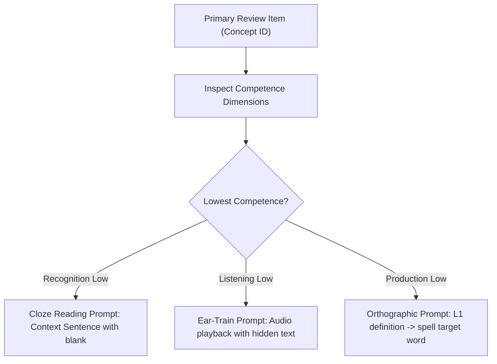

# LINGUA OS Knowledge System V2 — Review Integration Specification

**Status**: Approved Master Specification
**Baseline Commit**: `c2db86387e0879f56817cd748899e80f46b5d79a`
**Classification**: `PROPOSAL` (V2 Architecture) / `FACT` (Repository Alignment)
**Target Subsystems**: `services/api/src/lingua_api/review/`, `services/api/src/lingua_api/memory/`, `contracts/`

---

## 1. Executive Summary & Foundational Invariants

The Review subsystem governs the spaced repetition lifecycle in LINGUA OS. It is powered by the **py-fsrs 6.3.2** algorithmic engine, delivering mathematically optimal recall intervals while strictly preserving two core invariants:

```
+---------------------------------------------------------------------------------------+
|                              REVIEW SUBSYSTEM INVARIANTS                              |
+---------------------------------------------------------------------------------------+
| 1. SINGLE PRIMARY FSRS LINEAGE: Exactly one primary review item per (user, concept).  |
| 2. ATOMIC STATE MUTATION: Memory update and competence update commit together.        |
| 3. IDEMPOTENT RATING REPLAY: Submitting the same review twice produces identical state|
+---------------------------------------------------------------------------------------+
```

---

## 2. Review Item Lifecycle & Single Primary Lineage

### 2.1 Activation Triggers
A concept is activated into the FSRS review lifecycle via one of two paths:
1. **Explicit Library Save (`concept_save_intents`)**: The learner saves a word from the Reader or Dictionary.
2. **Today Plan New Concept Acceptance**: The learner completes an introductory learning activity generated by the Today engine.

### 2.2 Schema Enforcement
```sql
-- Enforces at most one active primary lineage per concept for each learner
CREATE UNIQUE INDEX uq_review_items_primary
ON public.review_items(user_id, concept_id)
WHERE lineage_type = 'primary';
```

### 2.3 Initial State Bootstrap
When initialized, an `fsrs_states` row is created with standard py-fsrs initial defaults:
- `stability`: None (for state 'New') or 0.0
- `difficulty`: None (for state 'New') or 5.0
- `due_at`: `clock_timestamp()`
- `state`: `'New'`
- `step`: 0
- `reps`: 0
- `lapses`: 0

---

## 3. Spaced Repetition Scheduling Engine (py-fsrs 6.3.2)

### 3.1 The 4 Standard Review Ratings
Learners submit one of four rating choices:
- `1` = `'Again'`: Total recall failure; card lapses into `'Relearning'`.
- `2` = `'Hard'`: Successful recall with significant cognitive strain; short interval increase.
- `3` = `'Good'`: Normal, successful recall; optimal interval increase matching target retention.
- `4` = `'Easy'`: Effortless recall; extended interval increase and difficulty reduction.

### 3.2 FSRS-6 Mathematical Alignment
All card transitions are executed strictly in Python via `FsrsSchedulerAdapter` using `py-fsrs 6.3.2`:
1. **Retrievability Calculation**:
   $$R(t, S) = \left(1 + \text{FACTOR} \cdot \frac{\text{elapsed\_days}}{S}\right)^{\text{DECAY}}$$
   Where:
   - $\text{elapsed\_days} = \max(0, (\text{now} - \text{last\_review}).\text{days})$.
   - $\text{DECAY} = -w_{20}$ (from active parameter set).
   - $\text{FACTOR} = 0.9^{1/\text{DECAY}} - 1$.
2. **Authoritative Execution**:
   - Python evaluates `scheduler.review_card()`.
   - The returned `next_card` provides updated `stability`, `difficulty`, `due`, `state`, and `step`.
   - Database row-locking (`SELECT ... FOR UPDATE`) prevents concurrent review submissions from conflicting.

---

## 4. Multi-Modal Prompt Generation (Unified Under One Lineage)

Rather than maintaining separate flashcard lineages for reading, listening, and spelling, LINGUA OS varies the **prompt modality** of the primary review item based on the learner's weakest competence dimension:



---

## 5. Review Queue Generation & Query Optimization

```sql
SELECT
    ri.id AS review_item_id,
    ri.concept_id,
    c.canonical_key,
    c.concept_type,
    fs.stability,
    fs.difficulty,
    fs.due_at,
    fs.state AS fsrs_state,
    ws.definition_en,
    ws.definition_vi,
    ws.ipa_us,
    ws.cefr_level,
    ucs.competence_score,
    ucs.rec_alpha, ucs.rec_beta,
    ucs.lis_alpha, ucs.lis_beta,
    ucs.prod_alpha, ucs.prod_beta
FROM public.review_items ri
JOIN public.fsrs_states fs ON fs.review_item_id = ri.id
JOIN public.concepts c ON c.id = ri.concept_id
LEFT JOIN public.concept_senses cs ON cs.concept_id = c.id AND cs.is_primary = TRUE
LEFT JOIN public.word_senses ws ON ws.id = cs.word_sense_id
LEFT JOIN public.user_concept_states ucs ON ucs.user_id = ri.user_id AND ucs.concept_id = ri.concept_id
WHERE ri.user_id = :authenticated_user_id
  AND ri.is_active = TRUE
  AND ri.suspended = FALSE
  AND fs.due_at <= :as_of_timestamp
ORDER BY fs.due_at ASC
LIMIT :queue_limit;
```

---

## 6. Transactional Review Submission & Feedback Loop

When a learner answers a review item (`POST /v1/review/items/{id}/answer`):
1. **Acquire Row Lock**: `SELECT ... FROM fsrs_states WHERE review_item_id = :id FOR UPDATE;`
2. **Compute FSRS Next State**: Run py-fsrs 6.3.2 state transition via `FsrsSchedulerAdapter`.
3. **Persist `review_events`**: Record historical review record with snapshot stability and scheduled interval.
4. **Update `fsrs_states`**: Update `stability`, `difficulty`, `due_at`, `state`, `step`, `reps`, `lapses`.
5. **Append `learning_events`**: Insert learning event with mapped score ($s = 1.0$ for Good/Easy, $0.5$ for Hard, $0.0$ for Again).
6. **Update Competence Projection (`user_concept_states`)**: Synchronously update modality beta distribution and re-evaluate status.
7. **Commit Transaction**.
