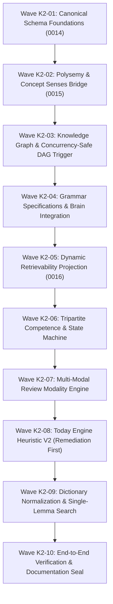

# LINGUA OS Knowledge System V2 — Implementation Waves Specification

**Status**: Approved Master Specification
**Baseline Commit**: `c2db86387e0879f56817cd748899e80f46b5d79a`
**Classification**: `PROPOSAL` (V2 Architecture) / `FACT` (Repository Alignment)
**Target Subsystems**: Project-wide execution roadmap

---

## 1. Executive Roadmap & Phasing Strategy

Knowledge System V2 is structured into ten sequential, reviewable execution waves (`K2-01` through `K2-10`). This phased decomposition eliminates large-blast-radius changes, ensures continuous CI green status, and allows independent review and rollback at each milestone.

---

## 2. Wave Breakdown & Specification

### Wave K2-01: Canonical Schema Foundations
- **Objective**: Deploy additive schema tables for grammar specifications, phrase templates, and phonetic transcriptions.
- **Dependencies**: Baseline migration `0013` (`0013_supabase_public_function_default_execute_lockdown_v1`).
- **Deliverables**:
  - `database/migrations/0014_knowledge_v2_canonical_structures.up.sql`
  - `database/migrations/0014_knowledge_v2_canonical_structures.down.sql`
  - SQLAlchemy models in `lingua_api/catalog/models.py`.
- **Verification Gate**:
  - Migration applies cleanly on clean PostgreSQL 17.11.
  - Rollback `.down.sql` executes cleanly pre-cutover.
  - Zero modifications to existing tables.

### Wave K2-02: Polysemy & Concept Senses Bridge
- **Objective**: Deploy additive `concept_senses` bridge table, preserving strict `lexemes` deduplication and morphology.
- **Dependencies**: Wave K2-01.
- **Deliverables**:
  - `database/migrations/0015_knowledge_v2_polysemy_resolution.up.sql`
  - `database/migrations/0015_knowledge_v2_polysemy_resolution.down.sql`
  - Unit tests verifying linking multiple word senses (*bank* [finance] and *bank* [river]) to distinct concepts under one lemma.
- **Verification Gate**:
  - Existing 108 starter catalog concepts retain exact UUIDs.
  - Single lemma row in `lexemes` with 0 duplicate morphology rows.

### Wave K2-03: Knowledge Graph & Concurrency-Safe DAG Trigger
- **Objective**: Expand relationship taxonomy in `concept_edges` and activate database-level DAG trigger backed by advisory transaction lock.
- **Dependencies**: Wave K2-02.
- **Deliverables**:
  - PostgreSQL trigger `trg_concept_edges_acyclic` with `pg_advisory_xact_lock`.
  - Recursive CTE repository queries in `lingua_api/catalog/graph_service.py`.
  - Concurrency test asserting zero cycles under simultaneous opposing writes.
- **Verification Gate**:
  - Attempted cyclic prerequisite insertion raises SQL error `check_violation`.
  - Depth-bounded ancestor queries execute in $< 5\text{ms}$.

### Wave K2-04: Grammar Specifications & Brain Integration
- **Objective**: Hydrate rich syntactic formulas, communicative functions, and L1 Vietnamese notes in Brain detail views.
- **Dependencies**: Wave K2-03.
- **Deliverables**:
  - DTO and repository methods for `grammar_specifications`.
  - Updated `GET /v1/brain/concepts/{id}` to return grammar details.
  - Contract update in `contracts/openapi.yaml`.
- **Verification Gate**:
  - `GET /v1/brain/concepts/{grammar_id}` returns non-empty pattern formula and Vietnamese explanations.
  - Brain frontend integration test passes.

### Wave K2-05: Dynamic Retrievability Projection
- **Objective**: Deploy `v_learner_concept_retrievability` view using exact py-fsrs 6.3.2 parameters ($w_{20}$ decay).
- **Dependencies**: Wave K2-04.
- **Deliverables**:
  - `database/migrations/0016_knowledge_v2_learner_retrievability.up.sql`
  - `database/migrations/0016_knowledge_v2_learner_retrievability.down.sql`
  - Benchmark script verifying view query latency $< 15\text{ms}$.
- **Verification Gate**:
  - Mathematical equivalence test against `Scheduler.get_card_retrievability` passes.
  - Concept with last review 90 days ago calculates $R < 0.50$ and dynamic `at_risk` status.

### Wave K2-06: Tripartite Competence & State Machine
- **Objective**: Formalize the dynamic state machine and multi-dimensional Beta updates across recognition, listening, production.
- **Dependencies**: Wave K2-05.
- **Deliverables**:
  - Service logic in `lingua_api/competence/service.py`.
  - Unit tests verifying Bayesian convergence and monotonic variance reduction.
- **Verification Gate**:
  - 100% test pass rate in `tests/backend/unit/test_competence.py`.

### Wave K2-07: Multi-Modal Review Modality Engine
- **Objective**: Enable dynamic prompt modality selection (cloze vs. ear-train vs. spelling) under the single primary FSRS lineage.
- **Dependencies**: Wave K2-06.
- **Deliverables**:
  - Prompt selection strategy in `lingua_api/review/prompt_generator.py`.
  - `GET /v1/review/items` contract update with modality envelope.
- **Verification Gate**:
  - Single primary lineage invariant holds across all prompt modalities.
  - Submitting review answer updates both FSRS stability and corresponding competence dimension.

### Wave K2-08: Today Engine Heuristic V2 (Remediation First)
- **Objective**: Upgrade Today Engine budget packing to prioritize overdue reviews and `at_risk` remediation before new concepts.
- **Dependencies**: Wave K2-07.
- **Deliverables**:
  - Implementation in `lingua_api/today/planner.py`.
  - Activity reason code mappings.
- **Verification Gate**:
  - Given a budget of 15 minutes and 20 overdue reviews, plan packs reviews first and allocates 0 new concepts.
  - Reason codes correctly reflected in API response.

### Wave K2-09: Dictionary Normalization & Single-Lemma Search
- **Objective**: Implement inflected form search via `lexeme_forms`, grouping multiple word senses under 1 lemma.
- **Dependencies**: Wave K2-08.
- **Deliverables**:
  - Search query enhancements in `lingua_api/dictionary/search.py`.
  - Integration tests covering inflections (*went* $\to$ *go*).
- **Verification Gate**:
  - Searching inflected words returns parent lemma and all senses with learner mastery badges.

### Wave K2-10: End-to-End Verification & Documentation Seal
- **Objective**: Execute full test pyramid, verify zero regressions against V1 baseline, and seal master documentation.
- **Dependencies**: Waves K2-01 through K2-09.
- **Deliverables**:
  - Complete CI test run report.
  - Sealed documentation in `docs/knowledge-v2/`.
- **Verification Gate**:
  - All automated tests green (512/512 backend, 711 frontend).
  - Zero untracked files or schema inconsistencies.
